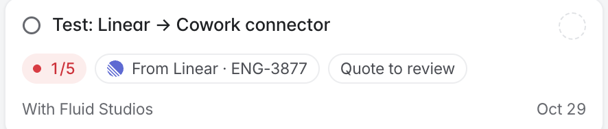

Once your Linear account is connected, adding the **Cowork** label to an issue sends it to Cowork as a ticket. Read [Connectors](/help/admin/cowork/connectors) first for how connectors behave.

## Connect your Linear account

<Steps>
  <Step title="Open Connectors">
    In the Fluid admin, open **Cowork** and click **Connectors** (or **Connect Linear**) in the board's toolbar.
  </Step>
  <Step title="Click Connect">
    In the **Linear** row, click **Connect**. Linear opens and asks you to approve Fluid's access.
  </Step>
  <Step title="Approve in Linear">
    Approve the request. You return to Connectors, and the **Linear** row shows your workspace and name with a **Connected** badge.
  </Step>
</Steps>

## Add a Cowork label in Linear

Fluid looks for a label named **Cowork**. It can be a workspace label or a team label. The name is matched without regard to capital letters or surrounding spaces, so `cowork` works too.

If your Linear workspace doesn't have one yet, create a label named **Cowork** in Linear's label settings.

## Send an issue to Cowork

Add the **Cowork** label to an existing issue, or create a new issue with the label. A Cowork ticket appears on your company's board, created by you. It carries:

- the issue's title;
- the issue's description;
- a link back to the issue in Linear.

The ticket card shows a chip naming the issue, for example **From Linear · ENG-123**.

<Frame caption="A ticket sent from Linear.">
  
</Frame>

## Reconnect or disconnect

- **Needs reconnecting:** if Linear stops accepting Fluid's access, the **Linear** row shows **Needs reconnecting**. Click **Reconnect** and approve again. Issues you label while disconnected aren't sent.
- **Disconnect:** click **Disconnect** in the **Linear** row. Labels you add afterwards create nothing. Tickets already created stay in Cowork.
