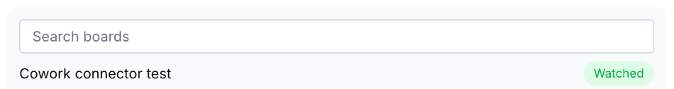
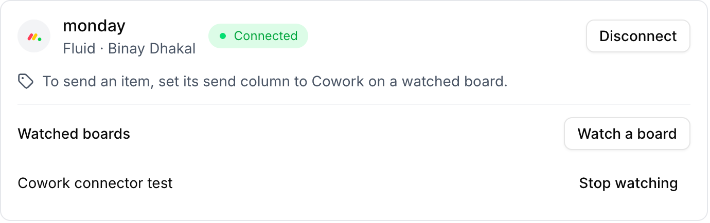
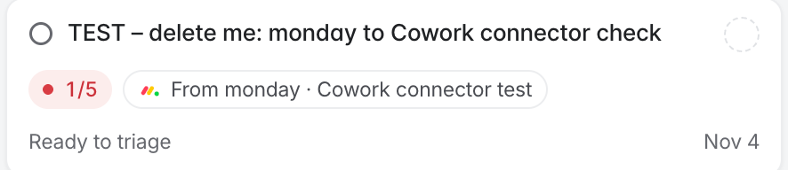
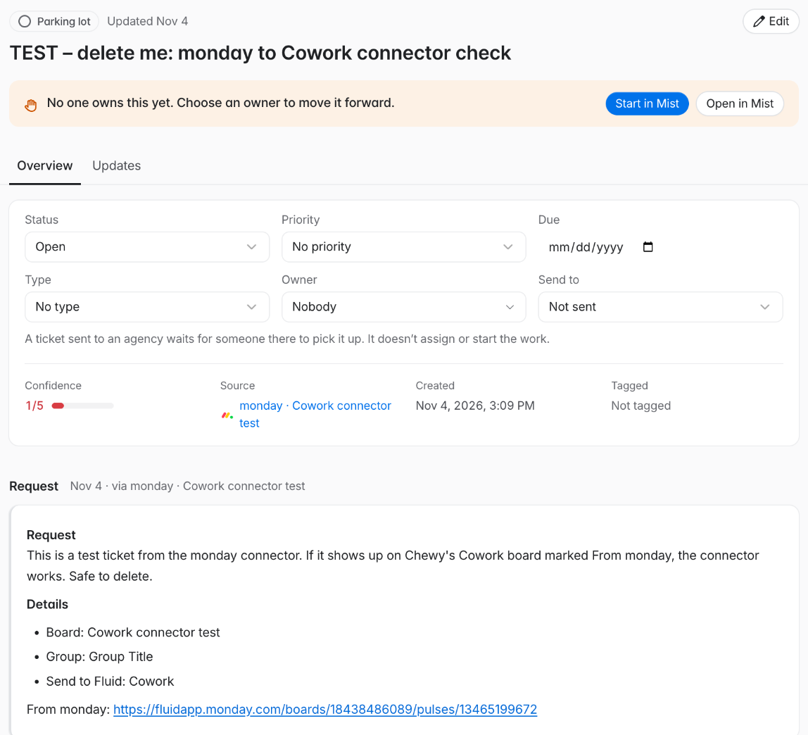

Sending monday items to Cowork takes two one-time steps: connect your monday account, then watch each board you want to send from. After that, setting an item's status to **Cowork** sends it to Cowork as a ticket. Read [Connectors](/help/admin/cowork/connectors) first for how connectors behave.

## Why you watch boards

monday only reports changes board by board, so Fluid has to listen to each board you send from. A board can also have several status columns, such as Status and Priority. When you watch a board, you choose which one is its **send column**: the column whose **Cowork** label sends an item.

## Prepare a board in monday

On each board you want to send from:

1. Pick a **status** column to be the send column, or add a new one, for example **Send to Fluid**.
2. Add a label named **Cowork** to that column.
3. Optionally, add a **long text** column for the request. Its text becomes the ticket's description.

## Connect your monday account

<Steps>
  <Step title="Open Connectors">
    In the Fluid admin, open **Cowork** and click **Connectors** in the board's toolbar.
  </Step>
  <Step title="Click Connect">
    In the **monday** section, click **Connect**. monday opens and asks you to approve Fluid's access.
  </Step>
  <Step title="Approve in monday">
    Approve the request. You return to Connectors, and the **monday** section shows your account and name with a **Connected** badge.
  </Step>
</Steps>

<Note>
  The first time anyone in a monday account connects, monday may ask for the
  Fluid Cowork app to be installed on that account. Installing apps needs a
  monday admin.
</Note>

## Watch a board

<Steps>
  <Step title="Open the board list">
    In the **monday** section, click **Watch a board**. Your boards are listed, with boards that already have a **Cowork** label first, marked **Ready**. Use **Search boards** to find a board by name, and **Load more boards** to see more.
  </Step>
  <Step title="Choose the send column">
    Next to the board, choose its send column. On a **Ready** board, the column with the **Cowork** label is already chosen.
  </Step>
  <Step title="Click Watch">
    Click **Watch**. The board moves to **Watched boards**. If its send column has no **Cowork** label yet, a message tells you to add one in monday.
  </Step>
</Steps>

<Frame caption="Search your boards. A board you already watch is marked Watched.">
  
</Frame>

<Frame caption="Your watched boards, each with Stop watching.">
  
</Frame>

## Send an item to Cowork

On a watched board, set an item's send column to **Cowork**. Within about a minute, a Cowork ticket appears on your company's board, created by you. It carries:

- the item's name as the title;
- the text of the item's long text columns as the description, or a note linking to the item if it has none;
- the item's board, group, and its status, date, timeline, people and dropdown values as details;
- a link back to the item in monday.

The ticket card shows a chip naming the board, for example **From monday · Client requests**. In the ticket, **Source** links back to the item.

<Frame caption="A ticket sent from monday.">
  
</Frame>

<Frame caption="The ticket's Source and Request, with the link back to the monday item.">
  
</Frame>

### What isn't copied

- **Updates** (monday's comments) are never copied.
- **Text, number, email, phone, link and other columns** are left out, so values your company's ticket readers aren't meant to see stay in monday.
- **Files** stay in monday. The ticket names them and links to the item.

## Stop watching or disconnect

- **Stop watching:** click **Stop watching** next to a board in **Watched boards**. Fluid stops listening to that board. Tickets already created stay in Cowork.
- **Disconnect:** click **Disconnect** in the **monday** section. Fluid also stops watching every board you watched, and items you send afterwards create nothing. Tickets already created stay in Cowork.
