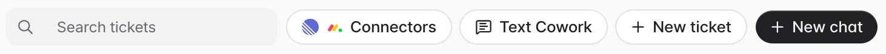
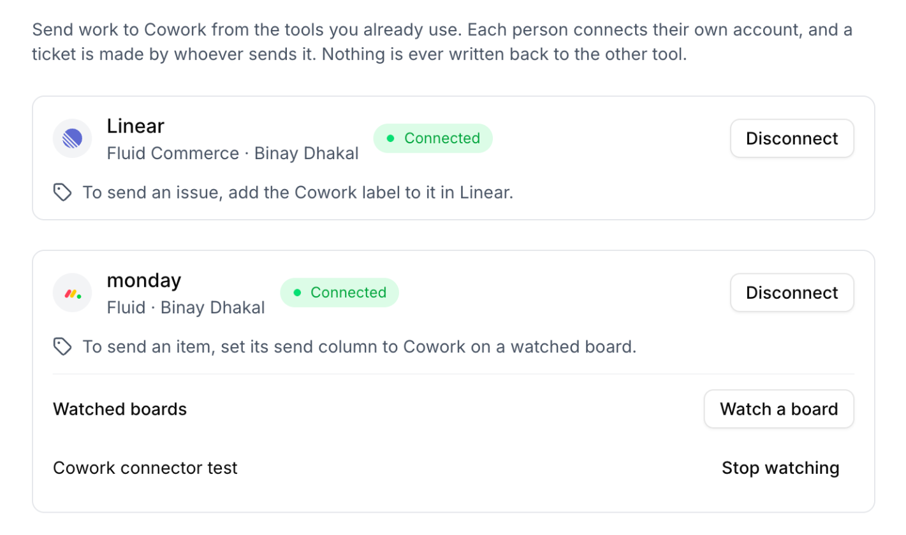

Connectors let you send work from the tools your team already uses straight to Cowork. You connect your own account once. After that, you send an issue or item by giving it the **Cowork** label in the other tool, and it becomes a Cowork ticket in your company.

## How connectors work

- **Each person connects for themselves.** A ticket is always created by the Fluid person who sent it. A label added by someone who hasn't connected creates nothing.
- **One way only.** Work comes into Cowork. Fluid never writes anything back to Linear or monday: no status changes, no comments, no links.
- **One ticket per issue or item.** Sending the same issue or item again doesn't make a second ticket.
- **Later edits stay in the other tool.** Changing the issue or item after it's sent doesn't change the ticket.

## Find the Connectors page

In the Fluid admin, open **Cowork**. Click **Connectors** in the board's toolbar. If only one tool is available, the button is named after it instead, for example **Connect Linear**.

<Frame caption="The Connectors button in the Cowork board's toolbar.">
  
</Frame>

<Frame caption="The Connectors page with Linear and monday connected.">
  
</Frame>

<Note>
  Connectors are being rolled out company by company. If you don't see the
  button, ask your Fluid contact to turn connectors on for your company. You
  also need permission to create Cowork tickets.
</Note>

## Choose your tool

<CardGroup cols={2}>
  <Card title="Linear" icon="list-check" href="/help/admin/cowork/connect-linear">
    Add the Cowork label to an issue to send it.
  </Card>
  <Card title="monday" icon="table-columns" href="/help/admin/cowork/connect-monday">
    Watch a board, then set an item's status to Cowork to send it.
  </Card>
</CardGroup>
