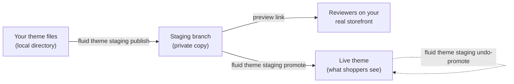

A theme branch is a private copy of a theme that you can change and preview without touching the live theme. Each theme has one branch, called **staging**. You publish your local theme files to staging with the Fluid CLI, open it on your real storefront through a preview link, share that link for review, and then **promote** staging to the live theme when it's right. If a promotion turns out wrong, you can undo it. Nothing you publish to staging reaches shoppers until you promote it.



## The workflow

<Steps>
  <Step title="Pull the theme">
    ```bash
    fluid theme pull
    ```
    Work in a theme directory bound to the theme you want to change. See [CLI](/themes/cli).
  </Step>
  <Step title="Create staging once">
    ```bash
    fluid theme staging request
    fluid theme staging wait
    ```
    Staging starts as an exact copy of the theme. You only do this once per theme.
  </Step>
  <Step title="Publish your changes to staging">
    ```bash
    fluid theme staging publish
    ```
    Only the files you changed are uploaded. The live theme isn't touched. Repeat as often as you like.
  </Step>
  <Step title="Preview and share">
    ```bash
    fluid theme staging status
    ```
    Open the preview link it prints, and send it to anyone who should review the change.
  </Step>
  <Step title="Check what promoting would change">
    ```bash
    fluid theme staging promote --dry-run
    ```
    It lists every file promoting would write or remove on the live theme. Nothing changes.
  </Step>
  <Step title="Promote staging to live">
    ```bash
    fluid theme staging promote
    ```
    It shows the same list, asks you to confirm, and then puts exactly what staging shows onto the live theme, all at once.
  </Step>
  <Step title="Undo if you need to">
    ```bash
    fluid theme staging undo-promote
    ```
    It puts the live theme back as it was before the promotion.
  </Step>
</Steps>

After a promotion, keep going: publish your next change to staging, preview it, and promote again.

## How theme branches work

**A branch is a copy of its theme.** Creating staging copies the theme: its templates, sections, settings, translations, files, and member sites. The copy belongs to the same company as the theme, and the theme it was copied from is called its parent.

**Each theme has one branch.** A draft or live theme can have one staging branch. It stays until its theme is deleted.

**A branch is hidden and protected.** The staging copy isn't listed with your other themes and can't be made live directly. It refuses edits from the theme editor and from a `fluid theme push` aimed at it. The only way to change it is `fluid theme staging publish`, so what staging shows is always something someone published to it.

**Every publish is recorded.** After each publish, Fluid records a snapshot of the branch: every file it serves, with a SHA-256 checksum of its content. Publishing, comparing, and promoting all work from these snapshots.

**A publish lands all at once.** A publish applies every changed file in one step. Anyone previewing staging sees the whole previous version or the whole new one, never half of each.

**Revisions keep publishes in order.** Staging starts at revision `0`, and each publish raises it by one. A publish is prepared against the revision it started from; if someone else published in the meantime, yours is refused instead of overwriting their work.

**Staging remembers where it started.** Staging also keeps a snapshot of the live theme it was based on: the copy it was created from, and after each promotion, what that promotion left on live. Promotion compares the live theme with this snapshot to make sure nobody changed live in the meantime.

**The preview is a signed link.** Staging is previewed on your real storefront domain through a link that carries a signed token for that one branch. The token can't be changed to open another theme or another company's store.

**A branch goes away with its theme.** Deleting a theme also deletes its staging branch, its snapshots, its preview link, and the files it stored. There's no separate command that removes staging.

| | Staging branch | Development theme | Unpublished theme |
|---|---|---|---|
| Created by | `fluid theme staging request` | `fluid theme dev` | `fluid theme push --unpublished` |
| How many | One per theme | One per project | As many as you push |
| Changed by | `fluid theme staging publish` only | The dev server, as you save | Pushes and the theme editor |
| Preview | A signed link anyone can open | Your local dev server | The admin's theme preview |
| Goes live | By promoting it | No | By publishing it |

## CLI commands

| Command | What it does |
|---|---|
| `fluid theme staging request` | Create the theme's staging branch, or follow the one being created |
| `fluid theme staging wait` | Wait until staging is ready or has failed |
| `fluid theme staging status` | Show staging's state and its preview link |
| `fluid theme staging publish` | Publish your local theme files to staging. The live theme isn't changed |
| `fluid theme staging compare` | Show how your local files differ from what staging serves. Nothing is changed |
| `fluid theme staging promote` | Put what staging serves onto the live theme, all at once |
| `fluid theme staging undo-promote` | Put the live theme back as it was before staging's latest promotion |

Run them from a theme directory you pulled with `fluid theme pull`. They use the theme this directory is bound to in `.fluid-theme.json`. Every command also takes:

| Option | Effect |
|---|---|
| `--theme <id>` (`-t`) | Use another theme, by ID |
| `--root <path>` | Read theme files from another directory |
| `--json` | Print machine-readable output. See [Scripts and coding agents](#scripts-and-coding-agents) |

`promote` and `undo-promote` also take:

| Option | Effect |
|---|---|
| `--yes` (`-y`) | Go ahead without asking. Required with `--json` or when no one is at the terminal |
| `--dry-run` | `promote` only: show what promoting would change and the latest promotion. Nothing is changed |
| `--snapshot <id>` | `promote` only: promote only this staging snapshot, the `snapshot_id` from a dry run. Refused if staging changed since |

## Create staging

<Steps>
  <Step title="Request staging">
    ```bash
    fluid theme staging request
    ```
    Fluid starts copying the theme in the background. If staging already exists or is already being created, the command reports where it stands instead of failing.
  </Step>
  <Step title="Wait until it's ready">
    ```bash
    fluid theme staging wait
    ```
    The command checks every few seconds and returns when staging is ready or has failed. It gives up after 600 seconds; set another limit with `--timeout <seconds>`. It exits with code 1 unless staging is ready.
  </Step>
  <Step title="Check it">
    ```bash
    fluid theme staging status
    ```
    It prints staging's state and, once it's ready, its preview link.
  </Step>
</Steps>

If creating staging fails, run `fluid theme staging request` again. It picks up where the copy stopped.

## Publish to staging

```bash
fluid theme staging publish
```

The publish sends your local theme files to staging, in three steps:

1. **Declare.** The CLI sends the path and SHA-256 checksum of every file, never its content.
2. **Upload.** Fluid compares the checksums with staging's snapshot and asks only for content it doesn't have. The CLI uploads just those files.
3. **Apply.** Fluid applies every changed file in one step, raises the revision, and records a new snapshot.

So a publish where you changed one template uploads and applies one file, and publishing again with nothing changed is quick.

- **Deleting a file locally doesn't delete it from staging.** A publish changes only the files you have.
- **Only the files you publish change.** An unpublished draft in a file next to one you publish, such as a template's head beside its content, stays unpublished on staging.
- **Member sites come along.** `members_sites.json` is published with the rest of the theme, without references to retired account and member pages. Fluid stores the member configuration it imports and may rewrite keys in it, for example a site key becoming the site's name.
- **If someone else published first,** your publish is refused. Publish again; the CLI reads the new revision.

Some files are never published to staging, and the command lists them as skipped:

| File | Why |
|---|---|
| Account and member page folders, such as `account_page/` | They're no longer theme files |
| Numbered duplicate templates, such as `page/home~2/index.liquid` | Rename them first |
| Files attached to a template, such as `page/home/assets/hero.png` | Not supported on branches yet |

One publish can hold up to 5,000 files, each up to 5 MB of text or 25 MB for images and other binary files.

## Compare with staging

```bash
fluid theme staging compare
```

Compare tells you whether staging serves exactly the files in your directory. It sends each file's checksum, never its content, and changes nothing.

```text
These files differ from staging (revision 4). Publishing to production sends these local files, not staging's.
  changed     sections/hero/index.liquid
  local only  sections/new-banner/index.liquid
  staging only page/about/index.liquid
```

| Label | Meaning |
|---|---|
| `changed` | The file is on both, with different content |
| `local only` | The file is in your directory but not on staging |
| `staging only` | The file is on staging but not in your directory, for example one a teammate published |

When nothing differs, it prints `These files match staging (revision 4).` `members_sites.json` is compared by its JSON content, not its exact bytes, because staging stores it in its own layout. Files a publish would skip aren't compared.

## Preview and share staging

`fluid theme staging status` prints staging's preview link. It opens staging on your real storefront domain, with a **Preview mode** banner at the top naming the staging theme.

- **Anyone can open it.** The link doesn't need a Fluid login, so you can send it to a reviewer.
- **It lasts 7 days.** Run `fluid theme staging status` again for a fresh link.
- **The preview stays on while you browse.** Following links on the storefront keeps showing staging in that browser until you choose **Exit preview** in the banner.
- **It stops working once staging is removed.** After that, the link shows the live theme.

<Warning>
  Cart and checkout in a staging preview act on your real store. Adding to the cart or checking out during a preview uses live data and can create real orders. Share staging links for review, not for test purchases.
</Warning>

Products or pages pinned to a specific template keep using the live theme's template in a staging preview.

## Promote staging to live

Promoting copies exactly what staging serves onto the live theme. You need permission to update themes.

```bash
fluid theme staging promote --dry-run
```

```text
Promoting staging changes the live theme:
  write  sections/hero/index.liquid
  write  assets/hero.png
Staging has not been promoted yet.
```

```bash
fluid theme staging promote
```

The command shows the same list and asks `Promote staging to the live theme?`. When you confirm, it prints how many files it wrote and removed.

How a promotion works:

- **It writes only what differs.** Files where live already matches staging are left alone. A file is removed from live only when it was removed on staging, never because it's missing from your directory.
- **It lands all at once.** Every change is applied in one step, so shoppers see the whole old theme or the whole new one, never a mix.
- **It's published straight away.** Promoted files go live as soon as the promotion finishes.
- **Drafts beside promoted files stay drafts.** A template's head, styles or content, and the theme's stylesheets, are separate files. Promoting one publishes only that file; an unpublished draft in a file next to it is left unpublished.
- **Images and other files are copied.** Binary files such as images are copied into files the live theme owns, so deleting staging can never break the live theme.
- **It promotes what you reviewed.** The promotion carries the staging snapshot it listed. If someone publishes to staging after you looked, the promotion is refused and you review again.
- **It's recorded.** Fluid records who promoted, when, and every file it changed, with its checksum before and after. That's what makes undo safe.

### When promotion is refused

Promotion only works while the live theme hasn't changed since staging was created or last promoted. It never merges: rather than overwrite someone's change to live, it refuses and changes nothing.

| You see | What happened | What to do |
|---|---|---|
| `The live theme already serves what staging does.` | Nothing to promote | Nothing; live is up to date |
| `The live theme changed since staging was based on it…` | Someone changed live another way, for example the theme editor or `fluid theme push` | Push your files with `fluid theme push` instead. See [Promote or push?](#promote-or-push) |
| `Staging changed since it was reviewed; review it again` | Someone published to staging after you looked | Run `promote --dry-run` again, then promote |
| `Staging is finishing a publication; try again shortly` | A publish to staging is still finishing | Wait a moment and promote again |
| `The live theme or the branch is changing; retry` | Someone was saving to the live theme at that moment | Promote again |

## Undo a promotion

```bash
fluid theme staging undo-promote
```

Undo puts back every file the latest promotion changed, exactly as it was, and removes the files the promotion added. It asks `Put the live theme back as it was before the latest promotion?` first.

- **Only the latest promotion, once.** You can undo staging's most recent promotion, and only once. Undo it, and you can promote again.
- **Other changes are kept.** Changes to live files the promotion didn't touch stay as they are.
- **Someone's later edit is never lost.** If a file the promotion wrote was changed on live since, undo refuses instead of throwing that change away.
- **Drafts come back.** Unpublished drafts that live files had before the promotion are restored, and a file that was never published before the promotion is left unpublished again. Undo refuses, rather than guess, when a draft can't be restored exactly, such as a member site draft.

| You see | What happened |
|---|---|
| `The live theme changed since this promotion` | A promoted file was edited on live since. Live changed outside promotion, so promoting this staging is refused too; fix it with `fluid theme push` |
| `This promotion was already undone` | It was undone already |
| `Only the branch's latest promotion can be undone` | A newer promotion exists; undo that one first |
| `An unpublished draft can't be restored by undo` | A member site draft from before the promotion can't be put back exactly; the files are listed below the message |

## Working as a team

Several people can publish to the same staging and promote it. Fluid checks every step, so nobody overwrites someone else's work by accident.

| Situation | What happens |
|---|---|
| Two people publish to staging at the same time | The first lands. The second is refused because the revision moved; they publish again and their changes land on top |
| A teammate published to staging after you | `fluid theme staging compare` shows their work as `changed` or `staging only`. Files only on staging stay when you publish, but a file you both have is replaced by your version, so bring their changes into your files first |
| Someone publishes to staging while you review a promotion | Your promotion is refused with `Staging changed since it was reviewed`. Review again so you never promote changes you didn't see |
| Someone edits the live theme, then you promote | The promotion is refused. Live is never overwritten |
| Someone is saving to live at the moment you promote | The promotion is refused without changing anything; promote again. A save that starts during a promotion waits for it to finish |
| Two people promote at the same time | The first promotion lands. The second is refused, so nothing is promoted twice |
| Someone edits a promoted file, then you undo | Undo is refused, so their edit is kept |
| Someone edits a different live file, then you undo | Undo goes ahead and keeps their edit |

Before you promote, review what promoting would write with `promote --dry-run`, not only your own files: staging holds everything everyone published to it.

## Promote or push?

There are two ways to change the live theme:

- **`fluid theme staging promote`** puts exactly what staging shows onto live. Use it when the change was reviewed on staging, especially when several people publish to it.
- **`fluid theme push`** sends the files in your directory straight to live. In Mist Desktop, **Publish** does the same.

<Warning>
  Promotion only works while every change to the live theme comes through promotion. After the live theme is changed any other way, such as `fluid theme push`, **Publish** in Mist, or the theme editor, promoting that staging is refused from then on, because promoting would overwrite that change. Keep going live with `fluid theme push` after that. For a team that reviews on staging, promote every change rather than mixing promote and push.
</Warning>

When you push instead of promoting, run `fluid theme staging compare` first. When it says your files match staging, the push sends exactly what you previewed.

## Scripts and coding agents

Every staging command takes `--json`:

| Command | JSON output |
|---|---|
| `status`, `request`, `wait` | `staging` (its state), `branch` (with `revision` and `preview_url`), and `operation` (any work still running) |
| `publish` | `branch` after the publish, `published` (files declared), `uploaded` (files sent), and `skipped` (each with its `reason`) |
| `compare` | `revision`, `matches`, and the `changed`, `localOnly`, and `branchOnly` paths |
| `promote --dry-run` | `preview` (`state`, `snapshot_id`, `writes`, `removals`) and `latest_promotion` |
| `promote --yes` | `promotion` (or `null` when live already matched) and the `preview` it promoted |
| `undo-promote --yes` | `promotion`, now `undone` |

A promotion has `id`, `branch_id`, `state` (`promoted` or `undone`), `promoted_at`, `promoted_by`, `undone_at`, and `undone_by`. The preview's `state` is `fast_forward` (there's something to promote), `in_sync` (live already matches), or `parent_changed` (live changed, so promotion is refused).

`promote` and `undo-promote` change the live theme, so with `--json` they refuse to run without `--yes`. To promote exactly what a script reviewed, pass the dry run's `snapshot_id`:

```bash
fluid theme staging promote --dry-run --json
fluid theme staging promote --snapshot <snapshot_id> --yes --json
```

On failure, a command prints one JSON object with an `error` holding the refusal's `type` and `message`, and exits with code 1.

## Messages you might see

| Message | What it means |
|---|---|
| ``No staging yet; request it with `fluid theme staging request`.`` | Staging hasn't been created |
| `Preparing staging…` or `Copying the theme…` | Staging is being created |
| `Staging is ready.` | You can publish, compare, preview, and promote |
| ``Staging failed (…); request it again to resume.`` | Run `fluid theme staging request` again |
| ``Staging is not ready. Run `fluid theme staging request` and wait for it first.`` | Publish or compare once staging is ready |
| `This theme cannot have a staging branch (only draft and live production themes can).` | Use a draft or live theme |
| `This changes the live theme; pass --yes to go ahead without a prompt.` | Add `--yes` to promote or undo from a script |
| `Theme update permission is required` | Ask an admin for permission to update themes |

For promotion and undo messages, see [When promotion is refused](#when-promotion-is-refused) and [Undo a promotion](#undo-a-promotion).

## In Mist Desktop

Mist Desktop runs the same commands for theme projects:

- **Staging tab.** Staging shows next to Local and Prod in the preview, with **Copy link** for a fresh preview link.
- **Publish to staging** sits beside **Publish**.
- **Staging status.** Next to the staging pill, Mist shows whether your local files are **Up to date with local** or have **Local changes not on staging**. Before **Publish** sends local files to live, it warns you when they differ from staging.
- **Promote to live** shows when staging has something to promote. It lists the files that would change and asks you to confirm. If staging changes while the dialog is open, Mist asks you to review again instead of promoting.
- **Undo promote** shows while the latest promotion can be undone.

**Promote to live** and **Undo promote** arrive in the Mist Desktop release after 1.5.0. Until you have it, promote and undo with the CLI.
