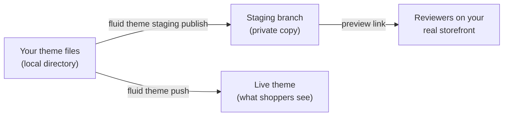

A theme branch is a private copy of a theme that you can change and preview without touching the live theme. Each theme has one branch, called **staging**. You publish your local theme files to staging with the Fluid CLI, open it on your real storefront through a preview link, share that link for review, and push the same files to your live theme when they're right. Nothing you publish to staging reaches shoppers.



## How theme branches work

**A branch is a copy of its theme.** Creating staging copies the theme: its templates, sections, settings, translations, files, and member sites. The copy belongs to the same company as the theme, and the theme it was copied from is called its parent.

**Each theme has one branch.** A draft or live theme can have one staging branch. It stays until its theme is deleted.

**A branch is hidden and protected.** The staging copy isn't listed with your other themes and can't be made live. It refuses edits from the theme editor and from a `fluid theme push` aimed at it. The only way to change it is `fluid theme staging publish`, so what staging shows is always something someone published to it.

**Every publish is recorded.** After each publish, Fluid records a snapshot of the branch: every file it serves, with a SHA-256 checksum of its content. Publishing and comparing work from that snapshot, which is how Fluid knows which of your files are already on staging.

**A publish lands all at once.** A publish applies every changed file in one step. Anyone previewing staging sees the whole previous version or the whole new one, never half of each.

**Revisions keep publishes in order.** Staging starts at revision `0`, and each publish raises it by one. A publish is prepared against the revision it started from; if someone else published in the meantime, yours is refused instead of overwriting their work.

**The preview is a signed link.** Staging is previewed on your real storefront domain through a link that carries a signed token for that one branch. The token can't be changed to open another theme or another company's store.

**A branch goes away with its theme.** Deleting a theme also deletes its staging branch, its snapshots, its preview link, and the files it stored. There's no separate command that removes staging.

| | Staging branch | Development theme | Unpublished theme |
|---|---|---|---|
| Created by | `fluid theme staging request` | `fluid theme dev` | `fluid theme push --unpublished` |
| How many | One per theme | One per project | As many as you push |
| Changed by | `fluid theme staging publish` only | The dev server, as you save | Pushes and the theme editor |
| Preview | A signed link anyone can open | Your local dev server | The admin's theme preview |
| Can go live | No | No | Yes, by publishing it |

## CLI commands

| Command | What it does |
|---|---|
| `fluid theme staging request` | Create the theme's staging branch, or follow the one being created |
| `fluid theme staging wait` | Wait until staging is ready or has failed |
| `fluid theme staging status` | Show staging's state and its preview link |
| `fluid theme staging publish` | Publish your local theme files to staging. The live theme isn't changed |
| `fluid theme staging compare` | Show how your local files differ from what staging serves. Nothing is changed |

Run them from a theme directory you pulled with `fluid theme pull`. They use the theme this directory is bound to in `.fluid-theme.json`. Every command also takes:

| Option | Effect |
|---|---|
| `--theme <id>` (`-t`) | Use another theme, by ID |
| `--root <path>` | Read theme files from another directory |
| `--json` | Print machine-readable output. See [Scripts and coding agents](#scripts-and-coding-agents) |

## Create staging

<Steps>
  <Step title="Request staging">
    ```bash
    fluid theme staging request
    ```
    Fluid starts copying the theme in the background. If staging already exists or is already being created, the command reports where it stands instead of failing.
  </Step>
  <Step title="Wait until it's ready">
    ```bash
    fluid theme staging wait
    ```
    The command checks every few seconds and returns when staging is ready or has failed. It gives up after 600 seconds; set another limit with `--timeout <seconds>`. It exits with code 1 unless staging is ready.
  </Step>
  <Step title="Check it">
    ```bash
    fluid theme staging status
    ```
    It prints staging's state and, once it's ready, its preview link.
  </Step>
</Steps>

If creating staging fails, run `fluid theme staging request` again. It picks up where the copy stopped.

## Publish to staging

```bash
fluid theme staging publish
```

The publish sends your local theme files to staging, in three steps:

1. **Declare.** The CLI sends the path and SHA-256 checksum of every file, never its content.
2. **Upload.** Fluid compares the checksums with staging's snapshot and asks only for content it doesn't have. The CLI uploads just those files.
3. **Apply.** Fluid applies every changed file in one step, raises the revision, and records a new snapshot.

So a publish where you changed one template uploads and applies one file, and publishing again with nothing changed is quick.

- **Deleting a file locally doesn't delete it from staging.** A publish changes only the files you have.
- **Member sites come along.** `members_sites.json` is published with the rest of the theme, without references to retired account and member pages. Fluid stores the member configuration it imports and may rewrite keys in it, for example a site key becoming the site's name.
- **If someone else published first,** your publish is refused. Publish again; the CLI reads the new revision.

Some files are never published to staging, and the command lists them as skipped:

| File | Why |
|---|---|
| Account and member page folders, such as `account_page/` | They're no longer theme files |
| Numbered duplicate templates, such as `page/home~2/index.liquid` | Rename them first |
| Files attached to a template, such as `page/home/assets/hero.png` | Not supported on branches yet |

One publish can hold up to 5,000 files, each up to 5 MB of text or 25 MB for images and other binary files.

## Compare with staging

```bash
fluid theme staging compare
```

Compare tells you whether staging serves exactly the files in your directory. It sends each file's checksum, never its content, and changes nothing.

```text
These files differ from staging (revision 4). Publishing to production sends these local files, not staging's.
  changed     sections/hero/index.liquid
  local only  sections/new-banner/index.liquid
  staging only page/about/index.liquid
```

| Label | Meaning |
|---|---|
| `changed` | The file is on both, with different content |
| `local only` | The file is in your directory but not on staging |
| `staging only` | The file is on staging but not in your directory, for example one a teammate published |

When nothing differs, it prints `These files match staging (revision 4).` `members_sites.json` is compared by its JSON content, not its exact bytes, because staging stores it in its own layout. Files a publish would skip aren't compared.

Run it before you push to live, especially when other people publish to the same staging.

## Preview and share staging

`fluid theme staging status` prints staging's preview link. It opens staging on your real storefront domain, with a **Preview mode** banner at the top naming the staging theme.

- **Anyone can open it.** The link doesn't need a Fluid login, so you can send it to a reviewer.
- **It lasts 7 days.** Run `fluid theme staging status` again for a fresh link.
- **The preview stays on while you browse.** Following links on the storefront keeps showing staging in that browser until you choose **Exit preview** in the banner.
- **It stops working once staging is removed.** After that, the link shows the live theme.

<Warning>
  Cart and checkout in a staging preview act on your real store. Adding to the cart or checking out during a preview uses live data and can create real orders. Share staging links for review, not for test purchases.
</Warning>

Products or pages pinned to a specific template keep using the live theme's template in a staging preview.

## Push to live

Staging doesn't go live by itself. When staging looks right, push the same files to your live theme:

```bash
fluid theme staging compare
fluid theme push
```

<Warning>
  `fluid theme push` sends the files in your directory, not what's on staging. If you edited files after your last staging publish, or a teammate published to staging from their own copy, live won't match what you reviewed. Run `fluid theme staging compare` first: when it says the files match staging, the push sends exactly what you previewed.
</Warning>

## Scripts and coding agents

Every staging command takes `--json`:

| Command | JSON output |
|---|---|
| `status`, `request`, `wait` | `staging` (its state), `branch` (with `revision` and `preview_url`), and `operation` (any work still running) |
| `publish` | `branch` after the publish, `published` (files declared), `uploaded` (files sent), and `skipped` (each with its `reason`) |
| `compare` | `revision`, `matches`, and the `changed`, `localOnly`, and `branchOnly` paths |

On failure, a command prints one JSON object with an `error` holding the refusal's `type` and `message`, and exits with code 1.

```bash
fluid theme staging compare --json
```

## Messages you might see

| Message | What it means |
|---|---|
| ``No staging yet; request it with `fluid theme staging request`.`` | Staging hasn't been created |
| `Preparing staging…` or `Copying the theme…` | Staging is being created |
| `Staging is ready.` | You can publish, compare, and preview |
| ``Staging failed (…); request it again to resume.`` | Run `fluid theme staging request` again |
| ``Staging is not ready. Run `fluid theme staging request` and wait for it first.`` | Publish or compare once staging is ready |
| `This theme cannot have a staging branch (only draft and live production themes can).` | Use a draft or live theme |

## In Mist Desktop

Mist Desktop runs the same commands for theme projects. Staging appears as a tab next to Local and Prod in the preview, with **Copy link** for a fresh preview link, and **Publish to staging** sits beside **Publish**.
